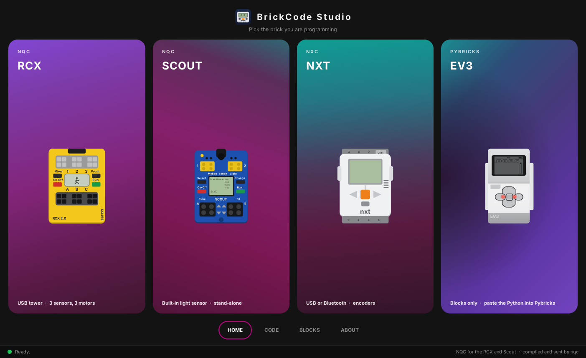
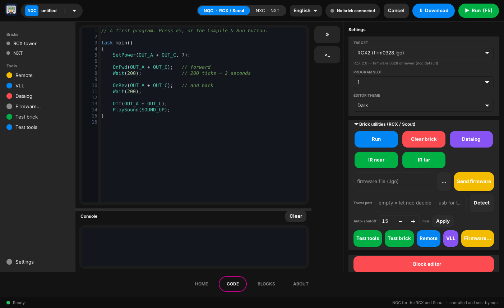
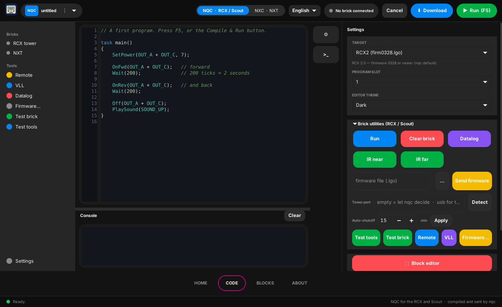
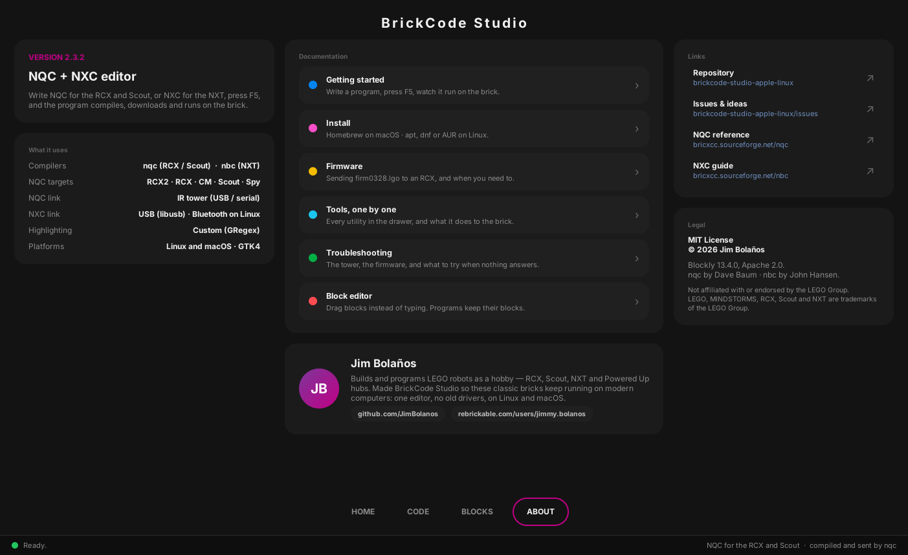
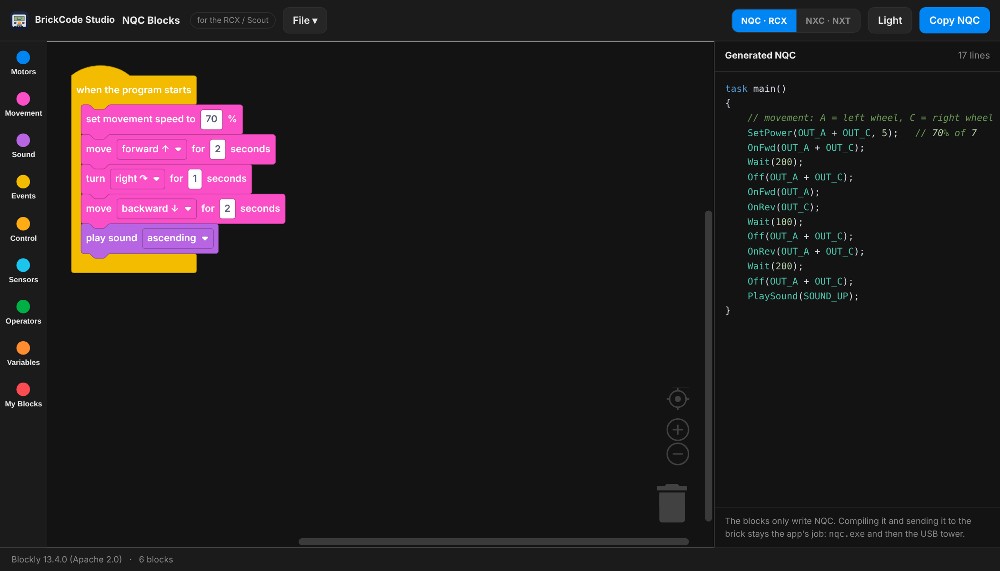
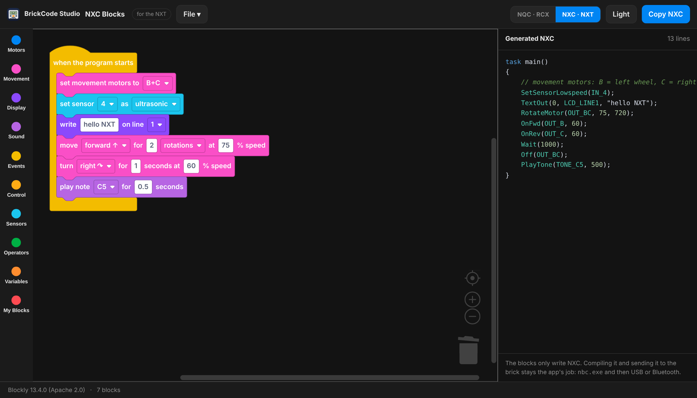
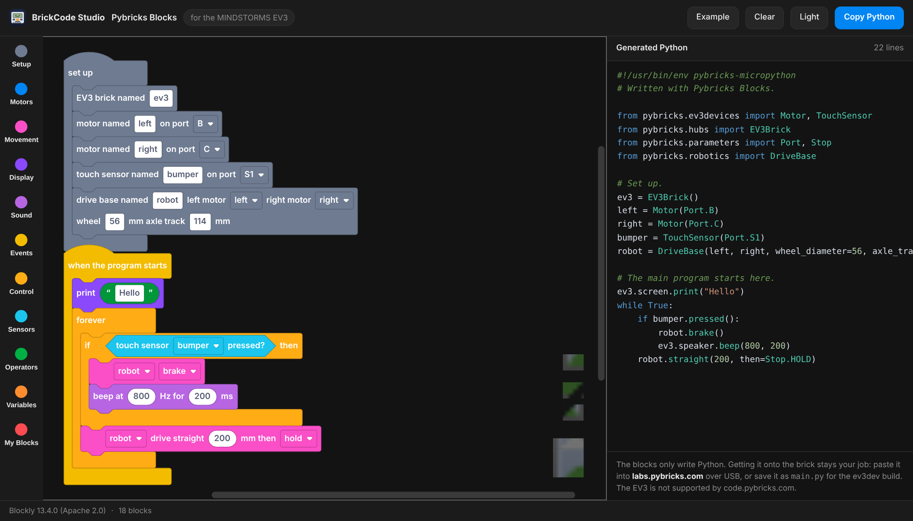
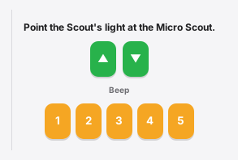
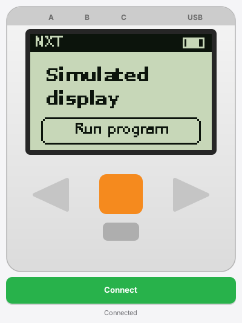

# BrickCode Studio

A native GTK4 + C editor that brings classic robot bricks back to life, in one window:

- **NQC** for the RCX, Scout and Spybotics (compiled and sent by `nqc`)
- **NXC** for the NXT (compiled by `nbc`; the app uploads and starts the program over USB with libusb)
- **Pybricks Python** for the EV3, written by a block editor (blocks only: you paste the code into Pybricks yourself)

Write a program, press **F5**, and it compiles, downloads and runs on the brick —
or drag blocks instead of typing, and the editor writes the NQC or NXC for you.
Works on **Linux** (Omarchy theme followed live) and **macOS on Apple Silicon**, with no vendor driver.
The interface is available in **English and Spanish** (selector in the top bar).

Pick the brick on the dashboard and the editor opens set up for it — language,
target and tools in one click.







The block editor, writing NQC for the RCX and NXC for the NXT:




And a third one for the EV3, writing Pybricks Python. Devices are named once
in a **set up** block, the way Pybricks does it, and every other block picks
one by name:



<p>


</p>
<p>


</p>

Full guide: [English](docs/USER_GUIDE.en.md) · [Español](docs/USER_GUIDE.es.md)

## What's new

The headlines of the 2.3 and 2.4 lines. Every release, down to the small
fixes, is in [CHANGELOG.md](CHANGELOG.md).

**An EV3 block editor (2.4).** A fourth card on the dashboard opens
[`pybricks`](pybricks), a block editor that writes Pybricks Python for the EV3,
with EV3 and NXT sensors, a drive base and the same palette as the other
editor. It only writes code: copy it and paste it into Pybricks.

**A dashboard.** The app opens on the three bricks it can program. Picking one
sets the language *and* the target together — until now those were two separate
controls in two different places — and drops you in the editor ready to type.

**A visual block editor.** **BLOCKS** in the bottom bar opens a small menu to pick
which one (RCX / Scout NQC, NXT NXC, or EV3 Pybricks); the button in the drawer
opens the one for the current mode. It opens in your browser. It writes NQC for the
RCX and Scout or NXC for the NXT, with the MINDSTORMS palette, and it works offline. Saved programs carry
their blocks inside a trailing comment, so you can open one again and keep
building where you left off — and both compilers ignore that comment, so the
program you send to the brick is byte for byte the same.

**The MINDSTORMS Robot Inventor look**, sampled colour by colour from the real
thing. The app now opens dark; Light is still one click away in Settings.

**NXT Screen**, the NXT display shown live on the computer over USB, drawn as the
brick, with clickable buttons and keyboard keys.

**A bottom bar**: HOME, CODE, BLOCKS, ABOUT. The editor itself is unchanged —
same sidebar, same console, same drawer, same utilities.

## What you need to connect

| Brick | How it connects to the computer |
| --- | --- |
| RCX, Scout (and Spybotics) | **LEGO USB Tower** (infrared). The program is sent through the tower, so the brick must be on, close to the tower and pointing at it. |
| NXT | **USB cable** straight to the computer. No tower needed. |

BrickCode Studio uses the **USB tower**. The older **serial tower** has not been tested yet. The tower is not included with this software; you need the original one that came with the RCX / Robotics Invention System 2.0. Details and permissions per system are in the install sections below.

## Features

- macOS-style interface: sidebar with Bricks and Tools, light and dark look, one program at a time
- Syntax highlighting, error line highlighted in the editor
- Compile / Run / Download from the top bar, console below
- Device chip: shows whether an NXT or an RCX tower is connected
- RCX tools: tower port detection, firmware sheet with a real progress bar, datalog, IR range, auto-shutoff
- NXT Explorer: files, battery and firmware over USB
- Visual block editor (**BLOCKS** in the bottom bar, the button on the editor screen, or **File → Block editor…**): drag blocks instead of typing, in NQC or NXC. It opens in your browser already set to the language the toolbar is on. Saved programs carry their blocks inside, so you can open them again and keep building — see [`blocks`](blocks).
- NXT Screen: the NXT display shown live on the computer over USB, drawn as the NXT brick, with clickable buttons (◀ Enter ▶ Exit) and keyboard keys to move through the NXT menus. Tested on macOS (Mac mini M4 with an NXT); still in testing on Linux.
- Remote (RCX): the buttons of the LEGO IR remote (messages, motors A/B/C, programs P1-P5, stop, sound), sent with `nqc`. The motor buttons run the motor while held, like the real remote. The installers patch nqc at build time so it does not wait for a reply the RCX never sends to remote commands (needed for the motor to keep running). Tested on a Mac mini M4 with an RCX 2.0.
- VLL (Scout): makes a Scout send VLL codes (motor forward / backward, beeps) to a Micro Scout, through the USB tower. Tested on macOS (Mac mini M4); still in testing on Linux.

## Install

| System | Status |
| --- | --- |
| macOS, Apple Silicon | Confirmed on a Mac mini M4 (RCX and NXT). |
| Linux Mint | Tested by COPERNICON (Eurobricks) with the RCX and the USB tower. NXT not tested yet. |
| Fedora | App built and run by COPERNICON. The tower could not be tested there (USB permissions). |
| Ubuntu / Debian | `linux/install-debian.sh` run end to end on Ubuntu 24.04: nqc, nbc and the app all build, and both compilers produce working output. No brick was attached, so the tower is still untested there. |
| Arch / Omarchy | Confirmed with RCX and NXT. |

The Spybotics target is in the menu but has not been tested on a real brick yet (the Scout was tested by COPERNICON). Feedback is welcome.

**VLL** and **NXT Screen** are confirmed on macOS; on Linux they are still in testing.

### macOS (Apple Silicon)

No drivers, no `sudo`, nothing to buy. It is built from source on your own
Mac, which is five steps in Terminal. Copy each block, paste it, press Return,
and wait for the prompt to come back before the next one.

**1. Open Terminal.** Press ⌘ Space, type `Terminal`, press Return. A window
with a text prompt appears — that is where everything below goes.

**2. Install Apple's developer tools.**

```
xcode-select --install
```

A window pops up: click **Install** and wait. If it says they are already
installed, that is fine, carry on.

**3. Install Homebrew**, which fetches the libraries this needs.

```
/bin/bash -c "$(curl -fsSL https://raw.githubusercontent.com/Homebrew/install/HEAD/install.sh)"
```

It asks for your Mac password — typing it shows nothing on screen, that is
normal. At the end it may print two `echo` lines and ask you to run them: do
that, they put Homebrew on your path. If Homebrew is already there, skip this.

**4. Download the code.**

```
git clone https://github.com/JimBolanos/brickcode-studio-apple-linux.git
cd brickcode-studio-apple-linux
```

**5. Install it.**

```
bash macos/install-mac.sh
```

This one takes a few minutes the first time — it builds two compilers from
source. It is done when it prints `Done.` and the prompt comes back.

Now open **BrickCode Studio** from your Applications folder, or with ⌘ Space.

**To update later**, two lines:

```
cd brickcode-studio-apple-linux
bash macos/update-mac.sh
```

It builds nqc, nbc and the app into `~/.local/brickcode` and creates `~/Applications/BrickCode Studio.app`.
The RCX needs its firmware once: gear button → Brick utilities → pick
`~/.local/brickcode/share/firmware/firm0328.lgo` (the installer copies it there) → Send firmware
(keep the RCX close to the tower and still, about 3-5 minutes).

### Debian, Ubuntu, Linux Mint

One script does all of it. Copy each block into a terminal, press Return, and
wait for the prompt before the next one.

**1. Open a terminal.** Ctrl-Alt-T on most desktops.

**2. Get git**, which is how you fetch the code.

```
sudo apt update && sudo apt install -y git
```

**3. Download the code.**

```
git clone https://github.com/JimBolanos/brickcode-studio-apple-linux.git
cd brickcode-studio-apple-linux
```

**4. Install.**

```
bash linux/install-debian.sh
```

It asks for your password once, for the packages, and near the end asks
whether to install the USB rule for the NXT — answer **y** unless you have no
NXT. The first run takes a few minutes: it builds `nqc` and `nbc` from source,
because neither is packaged with everything this needs.

Then open **BrickCode Studio** from the applications menu.

**To update later:**

```
cd brickcode-studio-apple-linux
git pull
bash linux/install-debian.sh
```

Plug the tower in and, in the app, set **Tower port** to `usb` — the **Detect**
button does it. To check the kernel sees the tower at all, run
`sudo dmesg --follow` while plugging it in: you should see
`registered new interface driver legousbtower`. If you have an NXT, unplug and
replug it after the install so the USB rule applies.

### Linux Fedora

Same shape, with `dnf`:

```
sudo dnf install -y git
git clone https://github.com/JimBolanos/brickcode-studio-apple-linux.git
cd brickcode-studio-apple-linux
bash linux/install-fedora.sh
```

It installs the dependencies, builds nqc, nbc and the app into
`~/.local/brickcode`, and offers the udev rule so the NXT works without root.
Unplug and replug the NXT afterwards.

### Linux, building the app alone

If you already have `nqc` and `nbc` and only want the app:

```
git clone https://github.com/JimBolanos/brickcode-studio-apple-linux.git
cd brickcode-studio-apple-linux/brickcode-studio
make
sudo make install
```

It needs the development packages for GTK4, libusb-1.0 and fontconfig —
`libgtk-4-dev libusb-1.0-0-dev libfontconfig-dev` on Debian and friends,
`gtk4-devel libusb1-devel fontconfig-devel` on Fedora. `make` needs no sudo,
only `make install` does. A good guide to installing NQC on Linux by hand:
https://brickbot.github.io/nqc/PLATFORM-Linux.html

For the RCX tower your user needs access to the device (group `dialout` or `plugdev`, depending on the distro); log out and in after adding it.

### Linux Ubuntu / Debian

Same steps as Linux Mint (Mint is based on Ubuntu). Not tested yet; please report what you find.

### Linux Arch / Omarchy

```
bash linux/install-arch.sh
```
Builds `nqc` (with the Remote patch and the Linux USB tower driver enabled), `nbc` and the app into `~/.local/brickcode`, copies the RCX firmware and offers the udev rule for the NXT. Only the `pacman` packages and the udev rule use `sudo`. Not tested yet on a clean Omarchy install.

Alternative with system packages: `cd nbc-git && makepkg -si`, then `cd ../brickcode-studio && makepkg -si`. The `nqc` from the AUR may not support `-getversion` (the *Test brick* button), so the installer above is recommended.

### Linux, other distros

Install the GTK4, libusb-1.0 and fontconfig development packages, then `cd brickcode-studio && make && sudo make install`.

## Firmware

The RCX needs a firmware once. `firm0328.lgo` and `firm0309.lgo` are included in the `firmware/` folder of this repo, and the installers copy them to `~/.local/brickcode/share/firmware/`. Descriptions of all firmware files are in the nqc repository:
https://github.com/jverne/nqc/tree/master/firmware

- `firm0328.lgo` is the RCX 2.0 firmware (target **RCX2**, the default). `firm0332.lgo` is the newest LEGO one and also works.
- `firm0309.lgo` is the original RCX 1.0 firmware (target **RCX**).

The target menu in BrickCode Studio shows the matching firmware file next to each name.

## Troubleshooting

Open the Brick utilities in the drawer and use **Test tools** (checks that `nqc` and `nbc` are found) and
**Test brick** / **Test NXT** (asks the brick for its version or battery, so you know the USB link works).

**Firmware fails with `!!!!` and `firmware transfer failed (-3)`.** The `!` marks are nqc retries and `-3` means the RCX did not answer.
Keep the RCX close to the tower and still, check the batteries, unplug and plug the tower again, and retry.
This failed once on a Mac mini M4 with a freshly reset RCX and worked on a later try, so the cause is not fully known.
If it keeps failing, load the firmware once with another tool or computer; BrickCode Studio works with it afterwards.

On Linux the RCX tower port must be `usb` (not `/dev/usb/legousbtower0`); the **Detect** button sets it for you.
If you get a permission error, add your user to the group that owns the tower (`dialout` or `plugdev`, depending on the distro) and log in again.

## Block editor

Prefer dragging blocks to typing? **File → Block editor…** opens
[`blocks/brickcode-blocks.html`](blocks) in your browser. It is one offline
file with the MINDSTORMS palette, and it writes NQC for the RCX and Scout or
NXC for the NXT.

Press **Save** there and open the file here with **File → Open…**. The
program carries its own blocks in a trailing comment, so opening it back in
the block editor restores exactly what you built. Both compilers ignore that
comment — the compiled program is byte for byte the same with or without it.

## Pybricks block editor (EV3)

The **EV3** card on the dashboard, or **File → Pybricks block editor (EV3)…**,
opens [`pybricks/pybricks-blocks.html`](pybricks) in your browser. It writes
Pybricks Python and nothing else: nothing is compiled or sent from here. Press
**Copy Python** and paste it into [labs.pybricks.com](https://labs.pybricks.com)
over USB (the EV3 is not supported by code.pybricks.com), or save it as
`main.py` for the ev3dev build. See [`pybricks/README.md`](pybricks/README.md).

## Examples

See the [`examples`](examples) folder: `forward_and_back.nqc`, `counter_to_display.nqc`, `button_to_light.nqc` (RCX) and `scout_button_light.nqc` (Scout); `forward_and_back.nxc` and `touch_sensor_motor.nxc` (NXT). Thanks to Copernicon for the touch-sensor and Scout examples.

## Español

BrickCode Studio es un editor nativo para programar ladrillos clásicos: **NQC** (RCX, Scout) y **NXC** (NXT).
Escribe el programa, pulsa **F5** y se compila, se descarga y se ejecuta en el ladrillo.
La interfaz está en inglés y español (selector en la barra superior). La instalación es la misma de arriba.

**Cómo se conecta cada ladrillo:** el RCX y el Scout se programan con la **torre USB de LEGO** (infrarrojo; el ladrillo debe estar encendido, cerca de la torre y apuntando a ella). La app usa la torre USB; la torre serial aún no se ha probado. El NXT se programa con un **cable USB** directo al computador, sin torre.

## About me / Acerca de mí

Hi, I'm **Jim Bolaños**. I build and program LEGO robots as a hobby (RCX, Scout, NXT and Powered Up hubs) and I write about them on my blog.
I made BrickCode Studio so these classic bricks can keep running on modern computers: one editor, no old drivers, on Linux and macOS.
If you find a bug or have an idea, open an issue here or find me at [github.com/JimBolanos](https://github.com/JimBolanos). My builds are on [Rebrickable](https://rebrickable.com/users/jimmy.bolanos/).

Hola, soy **Jim Bolaños**. Programo robots de LEGO como pasatiempo (RCX, Scout, NXT y hubs Powered Up) y escribo sobre ellos en mi blog.
Creé BrickCode Studio para que estos ladrillos clásicos sigan funcionando en computadoras modernas: un solo editor, sin drivers viejos, en Linux y macOS.
Si encuentras un error o tienes una idea, abre un issue aquí o búscame en [github.com/JimBolanos](https://github.com/JimBolanos). Mis creaciones están en [Rebrickable](https://rebrickable.com/users/jimmy.bolanos/).

## Thanks / Agradecimientos

Thanks to **COPERNICON** from the Eurobricks forum for providing feedback and installing BrickCode Studio on Fedora Linux.

Gracias a **COPERNICON** del foro Eurobricks por dar su opinión e instalar BrickCode Studio en Fedora Linux.

## Notes

- nbc is built compile-only; sending the program to the NXT is done by the app itself.
- Settings are stored in `~/.config/brickcode-studio/settings.ini`.

## Legal

BrickCode Studio is an independent project. It is not affiliated with, or endorsed by, the LEGO Group.
LEGO and MINDSTORMS are trademarks of the LEGO Group. nqc (Mozilla Public License) and nbc (GPL) are separate programs by their authors.

MIT License - © 2026 Jim Bolaños · [github.com/JimBolanos](https://github.com/JimBolanos)
